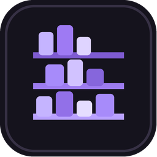

# KageShelf

<p align="center"></p>

**A local-first desktop organizer for anime libraries prepared for Jellyfin.**

> **Release status:** `1.0.0` — stable release. Downloadable packages are published through GitHub Releases.

KageShelf helps you turn a folder of downloaded episodes into a reviewable, Jellyfin-friendly library structure. It is built with Electron, React, and TypeScript for Windows and Linux. Media files stay on your computer: the app scans locally and only contacts AniList when you search for anime metadata.

## Features

- **Local library scanning** for supported video files and matching subtitle sidecars.
- **AniList metadata lookup** with explicit, manual association saved locally.
- **Episode corrections** for cases where automatic filename detection needs help.
- **Reviewable organization plans** with proposed paths and destination-conflict checks before any copy begins.
- **Verified copying** using SHA-256 checks, with the source files left untouched.
- **Execution history and recovery** including cancellation, resume, and guarded rollback of files the app can prove it created.
- **Desktop interface** built with React, Electron, TypeScript, and Lucide icons.

## Downloads

Download the latest release from the [GitHub Releases page](https://github.com/GuilhermeCanina/kageshelf/releases). Published packages are currently intended for **Windows x64** and **Linux x64**.

- **Windows Setup:** guided installer with Start Menu and Desktop shortcuts.
- **Windows Portable:** run without installing.
- **Linux AppImage:** single-file application package.

Windows binaries are not code-signed, so Windows SmartScreen or antivirus software may show a warning. On Linux systems without FUSE 2, an AppImage may need to be launched with `--appimage-extract-and-run`.

## Development

### Requirements

- Node.js 24 (see `.nvmrc`)
- npm

### Install and run

```bash
npm ci
npm run dev
```

### Quality checks

```bash
npm run typecheck
npm test
npm run build
npm audit --audit-level=high
```

Or run the first three checks together:

```bash
npm run validate
```

### Package locally

```bash
# Windows x64: NSIS installer + portable executable
npm run package:windows

# Linux x64: AppImage
npm run package:linux
```

Artifacts are written to `release/` and are intentionally excluded from Git. Windows packages should be built and smoke-tested on Windows; Linux packages should be tested on the target distribution.

## Safe operation

KageShelf starts with a read-only preview. Review the proposed organization plan and approve it explicitly before copying. Existing destination files are treated as conflicts; they are not silently overwritten. Keep a backup of important libraries and test with disposable folders before processing a large collection. Rollback is conservative and removes only files whose ownership and integrity can be verified.

The app keeps the legacy local application-data directory during the rename from Jellyfin Anime Supremo so existing associations, episode corrections, and execution history remain available. The installer retains the legacy application ID to support an in-place upgrade from the release candidate. The stable `1.0.0` release should only be tagged after the RC passes CI and real-platform smoke tests.

## License

KageShelf is distributed under the MIT License. Third-party notices are listed in [`THIRD-PARTY-NOTICES.md`](THIRD-PARTY-NOTICES.md).

## Em português

O KageShelf é um organizador desktop local de bibliotecas de anime para Jellyfin. Ele oferece prévia antes de copiar, associação manual com o AniList, correção de episódios, detecção de conflitos, cópia verificada por SHA-256 e histórico com retomada e reversão protegida. Os arquivos de mídia permanecem no computador.
